# KOReader Patches

User patches for KOReader, mostly tested for Kobo Clara Color. Each one is a single file that patches KOReader or a plugin in memory. Nothing on disk is modified, so deleting a file and restarting fully reverts it.

## Install

Copy the `2-*.lua` files you want into KOReader's patches folder and restart KOReader.

- Kobo: `.adds/koreader/patches/`
- Kindle: `koreader/patches/`
- Android: `koreader/patches/`

Create the folder if it doesn't exist. The `2-` prefix is required: KOReader only loads patches whose names start with a supported priority number (`0`, `1`, `2`, `8`, `9`), and `2-` is the one that runs after the UI is ready, which is what these patches need. Patches don't work on the F-Droid build of KOReader.

All patches work independently and together. If one fails to attach (for example, after a plugin update), it logs to `koreader/crash.log` and leaves things as they were. Each patch logs its version to `crash.log` on startup.

**Upgrading from SimpleUI Mod:** the patch is now `2-simpleui-tweaks.lua`. Delete `2-simpleui-mod.lua` (a leftover copy is skipped, but there's no reason to keep it). Your saved settings carry over.

| Patch | File | Requires | Version |
|---|---|---|---|
| [SimpleUI Tweaks](#simpleui-tweaks) | `2-simpleui-tweaks.lua` | simpleui.koplugin | 2.12.0 |
| [Add-ons menu](#add-ons-menu) | `2-tweaks-menu.lua` | none | 1.0.5 |
| [Patch Backup & Restore](#patch-backup--restore) | `2-backup-patches.lua` | zip-capable KOReader build (2024+) | 2.4.0 |
| [Debugging Menu](#debugging-menu) | `2-debugging-menu.lua` | Add-ons menu | 1.3.3 |
| [Network Tweaks](#network-tweaks) | `2-network-tweaks.lua` | Kobo or Kindle for background connect | 1.10.3 |
| [ShelfSync Tweaks](#shelfsync-tweaks) | `2-shelfsync-tweaks.lua` | ShelfSync | 1.11.13 |
| [ReadMastery Notify](#readmastery-notify) | `2-ReadMastery-notify.lua` | ReadMastery | 1.0.4 |
| [ReadMastery Quests](#readmastery-quests) | `2-ReadMastery-quests.lua` | ReadMastery (Notify optional) | 1.0.4 |
| [Kobo Style Sleep Screen Banner](#kobo-style-sleep-screen-banner) | `2-kobo-style-sleepscreen-banner.lua` | none | 1.1.3 |
| [Track Reading Location](#track-reading-location) | `2-track-reading-location.lua` | none | 1.9.4 |
| [Shortcuts Toolbar Icon Tweaks](#shortcuts-toolbar-icon-tweaks) | `2-shortcutstoolbar-icon-tweaks.lua` | shortcutstoolbar.koplugin | 1.14.3 |
| [Shortcuts Toolbar Quick Shelf](#shortcuts-toolbar-quick-shelf) | `2-shortcutstoolbar-quick-shelf.lua` | shortcutstoolbar.koplugin | 1.2.1 |
| [X-Ray Direct Lookup](#x-ray-direct-lookup) | ~~`2-xray-direct-lookup.lua`~~ | xray.koplugin | discontinued |
| [Reading Insights Tweaks](#reading-insights-tweaks) | `2-readinginsights-tweaks.lua` | readinginsights.koplugin + CoverBrowser | 2.0.0 |
| [QuickMenu Toggle State](#quickmenu-toggle-state) | `2-quickmenu-toggle-state.lua` | none | 1.0.4 |
| [List Rating Progress](#list-rating-progress) | `2-list-rating-progress.lua` | none | 1.0.0 |
| [Custom Quotes for SimpleUI](#custom-quotes-for-simpleui) | `Quotes.lua` | simpleui.koplugin | n/a |

Versioning across the patches: `1.0.x` is a fix, `1.x.0` is a new feature, and `2.0.0` is a change that affects how existing saved settings or backups work.

## Diagnostic patches

The `debug/` folder holds temporary troubleshooting companions for the main patches (`2-zz-*-diagnostics.lua`). They change nothing — each one watches its main patch and writes timestamped, tagged lines to one shared log (`koreader/diagnostics.log`) for a short window after every start, then goes quiet, and stops entirely 24 hours after install. Manage them with the Debugging Menu (toggle, view, combine, delete). See [debug/README.md](debug/README.md).

---

## SimpleUI Tweaks


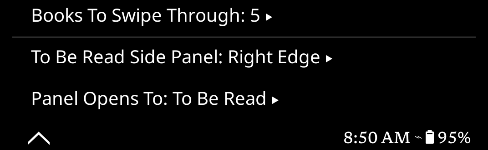
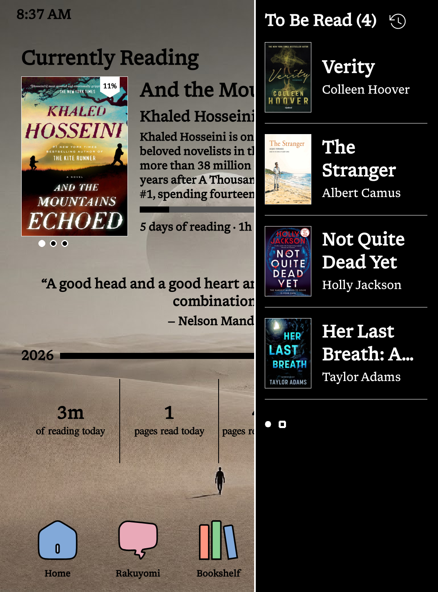
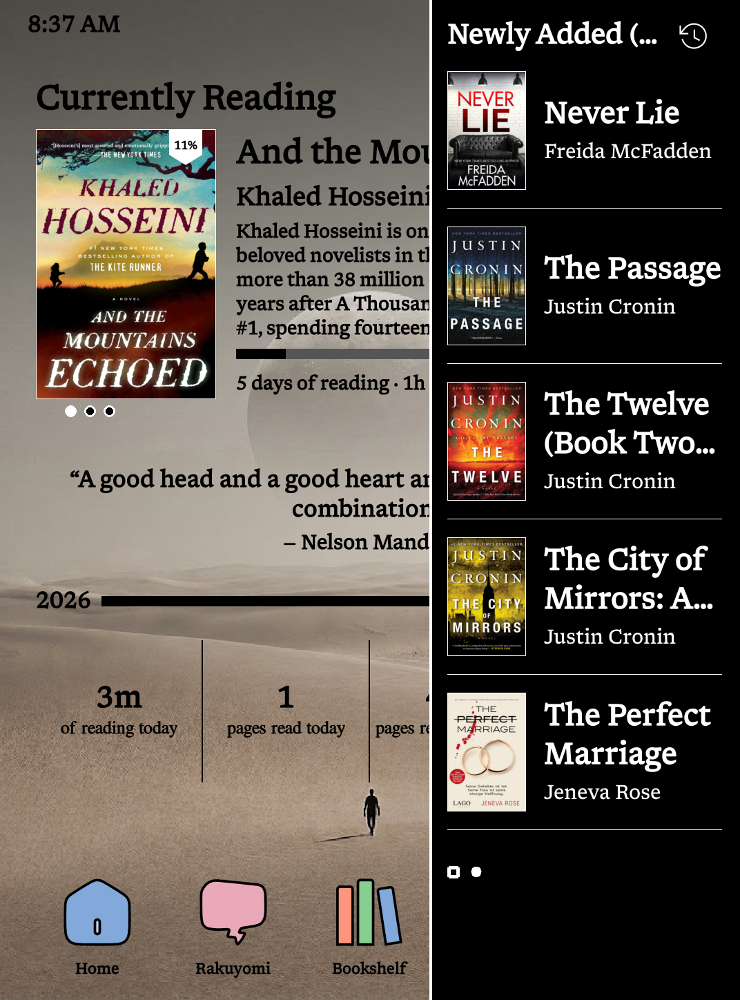

Colour and typography control for the SimpleUI home screen, plus a Night Mode "day look" for use with a light wallpaper.

Settings: Tools → SimpleUI Tweaks (or Tools → Add-ons → SimpleUI Tweaks with the Add-ons menu installed).

- **Modules:** text colour with a separate Night Mode colour, set for all modules and overridable per module. Recolour grey text, progress bar/ring/border colours per module, bold per module or all.
- **Currently Reading:** swipe left/right to step through your most recent books still in progress (4 by default, 2-6; finished ones skipped), with dots on the cover showing where you are. Tap opens the book shown.
- **Section titles:** defaults for all sections, then per-module colour, bold and size (preset or custom 50-300%). A `•` marks customised sections.
- **Nav bar:** bold labels, day look in Night Mode, colour icons keep their original colours in Night Mode.
- **Status bar:** bold, and day look in Night Mode.
- **KOReader's own icons in Night Mode:** menu tab icons (chosen one by one), menu arrows and Quick Actions icons can keep their original colours (each a toggle, off by default). Useful for colour icons swapped in via `koreader/icons/`.

Colours are picked as they should look on screen; Night Mode inversion is handled for you. Night Mode switches and status bar bold apply instantly, and everything else asks for a restart. Settings are saved to disk straight away, so they survive a crash, power-off or patch update. Works with SimpleUI's own "Don't Invert Colored Icons in Night Mode" (no double flip) and with its custom tab icons.

**Notes**
- Wallpaper: turn off SimpleUI's own wallpaper Night Mode inversion, since black text needs a light background.
- Module fill: with a light wallpaper, set module backdrop/fill to 0, or text can disappear in Night Mode.
- Colour nav icons need a non-Framed nav bar style (Framed draws icons in one colour but still gets the day look).
- Icon files: use SVG icons with transparency.
- Section title sizes multiply SimpleUI's own label scale (Scale → Labels).

**Uninstall:** use Reset to defaults if you want the saved settings (`simpleui_mod` in `settings.reader.lua`) removed, then delete the file and restart.

---

## Add-ons menu

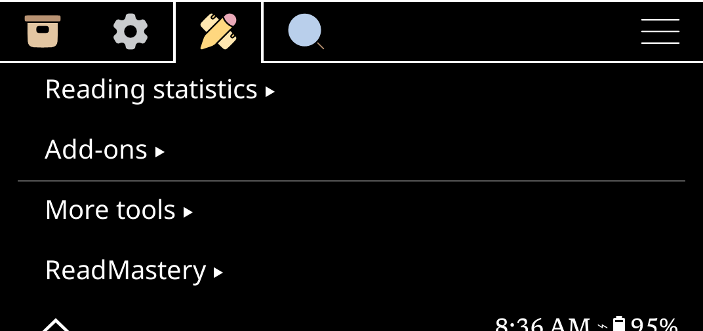
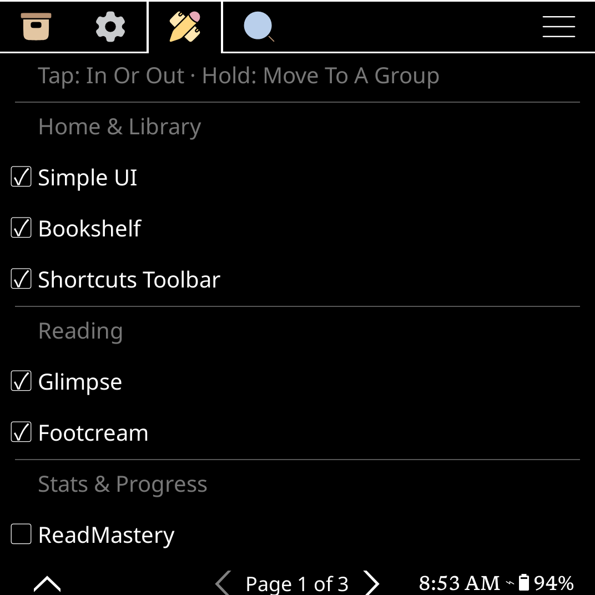

One **Tools → Add-ons** menu for plugins and patches. It gathers plugin menus (grouped, in an order you can edit near the top of the file) and patch settings into a single place, so Tools stays uncluttered. Moved plugins work exactly the same.

- **Auto-collect:** newly installed plugins and patches that add a menu are found automatically. You get a one-time notice and they show up marked "New" under "Other" in "Choose What's In Add-ons".
- **Choose What's In Add-ons** (bottom of the list): tap an item to turn it on or off (off puts it back where it was), hold it to move it to another group. Both apply after a restart.
- **Safe to remove:** KOReader's menu order is never modified. Delete the file and restart and every menu goes back where it was. Only your Add-ons choices are saved, in `settings.reader.lua`. IDs that don't exist are skipped, and items hidden with Menu Disabler stay hidden.

For patch authors: register with the shared table at `package.loaded.tweaks_mods`. The format is documented at the top of the file. Return an item with `sub_item_table_func` so large menus are only built when opened.

---

## Patch Backup & Restore

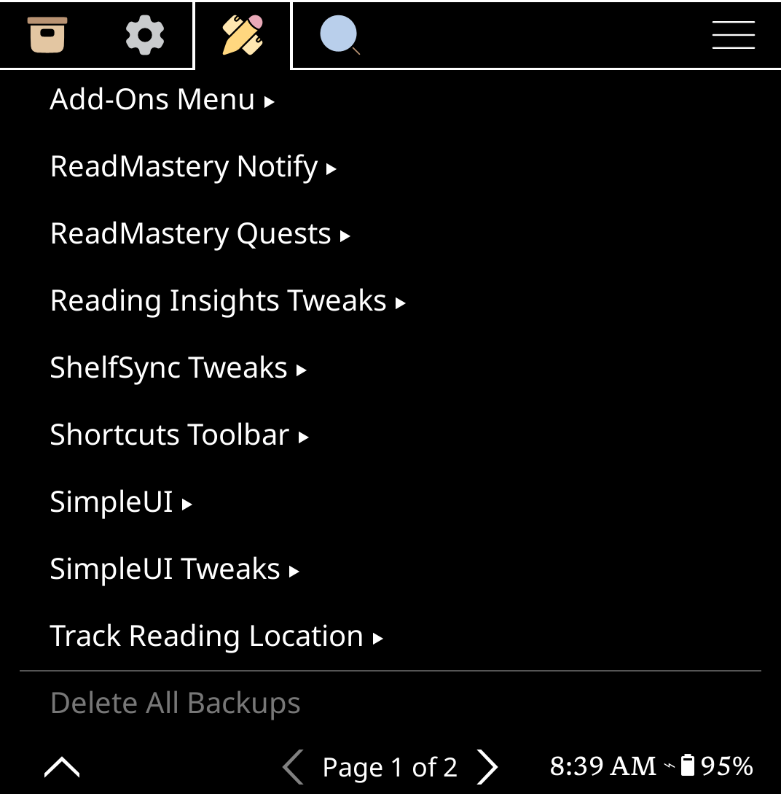

Per-patch backups, icon cleanup, and better device backups via Device Backup & Restore (`backup.koplugin`, build 26.9.29+ for icons). Tested with backup.koplugin 26.9.28.3 (stable, no icons), 26.9.29-beta and 26.9.30-beta; recheck after a major update to it, SimpleUI or ShelfSync, since this patch relies on how they store settings and logins.

Menu: **Tools → Patch Backup & Restore** (or **Tools → Add-ons → Patches** once `backup_patches` is in the Add-ons menu's `PATCH_MENUS` list).

```
Patch Backup & Restore
├─ Shortcuts toolbar, SimpleUI, …   one entry per target you use
│  ├─ Back up now
│  ├─ Restore latest
│  └─ History                      every backup: restore or delete,
│                                   or delete all of this target's
├─ Delete all backups              every target's, safety backups too
├─ Icons
│  ├─ Tidy icons
│  └─ Unused icons
├─ Logins in device backups        off by default
└─ Check for Patch Updates         update patches on the device
```

- **Back up now:** the target's settings, any settings files it keeps in `koreader/settings/`, and every icon its settings point to, in one zip at `koreader/backups/<target>/<target>_<date>.zip`.
- **Restore:** puts settings and files back, unpacks icons into the target's icon folder and repoints settings there. Takes a "before restore" safety backup first (and stops if it can't), then asks to restart. "Restore latest" skips those automatic safety backups.
- **Tidy icons:** copies every icon a target uses into its own flat folder (`koreader/icons/<target>/`; SimpleUI uses its own `sui_icons/`) and repoints settings there. Originals stay put. Takes a "before tidy" backup first.
- **Unused icons:** icons nothing points to, across `koreader/icons/` subfolders and SimpleUI's `sui_icons/` (packs included). Delete one at a time or all at once; emptied folders and packs go too. Loose files directly in `koreader/icons/` and KOReader's built-in icons are never touched.
- **Notifications:** with Network Tweaks installed, results (backed up, deleted) follow its notification style: Banner, Minimal corner note, or Normal popup. Questions, restart prompts and failures always stay popups.
- **Check for Patch Updates:** updates all 26 patches on the device from this repo's `patch-versions.lua` manifest (14 main patches + 12 diagnostics, maintained one line per release) over Wi-Fi — no login, no Google Drive. Every patch is listed under Patches / Diagnostics headings as Up to Date, version → version, Installed Is Newer, Not Installed or Unknown Version; rows are tappable — tapping one pops up its actions: Update / Reinstall / Install depending on its state, plus Remove for any installed patch (except the updater itself; removing a main patch offers to also remove its paired diagnostics file). Update All is always listed (with nothing outdated it just says so). Plugin entries (`.koplugin.zip`) download, unzip into `koreader/plugins/`, and version-check via the plugin's `_meta.lua`. Downloads are forward-only into `koreader/patches/` (a diagnostic updates where its copy sits: `patches/` if active, `patches/debug/` if switched off), showing each patch name as it downloads, with a success/failure summary, then asks to restart. Wi-Fi turns on automatically if off and stays on afterwards.

**Device Backup & Restore integration:** with Settings and Icons ticked, every icon a target uses is included (wherever it lives) plus a map of its old paths, so restoring on another device (Kobo, Kindle, Android) re-links correctly. The Logins toggle is off by default: saved logins, session tokens and the keys that decrypt them (ShelfSync, ShelfSync tweaks, backup cloud credentials) are excluded, including from Beam. Files that mix tokens with normal settings go in with only the tokens stripped, and a restore keeps the device's own logins. Turning it on includes everything, so keep that backup file private.

Built-in targets: Shortcuts toolbar, Track Reading Location, Add-ons menu, Reading Insights tweaks, ReadMastery Notify/Quests, ShelfSync tweaks (settings only, never logins), and SimpleUI. Targets you don't use stay hidden.

**For patch authors, add a target:**
```lua
local BK = package.loaded.backup_patches or { targets = {} }
package.loaded.backup_patches = BK
BK.register{            -- or table.insert(BK.targets, {...}) if not loaded yet
    id = "mything", text = "My thing",
    setting_prefix = "mything",     -- optional: G_reader_settings keys
    files = { "mything.lua" },      -- optional: files in koreader/settings/
    store = function(from_disk)     -- optional: settings kept in your own
        return data_table, flush_fn --   file (every key, or those
    end,                            --   matching setting_prefix)
    icon_dir = "/abs/folder",       -- optional: where Tidy puts icons
    library_dirs = { "/abs/dir" },  -- optional: icon folders Unused cleans fully
}
```
and declare secrets kept out of device backups (names relative to `koreader/settings/`):
```lua
BK.addSecrets{ files = { "x_login.lua" }, folders = { "x_session" },
               keys = { ["x_settings.lua"] = { "api_token" } } }
```

Needs a KOReader build with zip support (`ffi/archiver`, 2024+).

---

## Debugging Menu

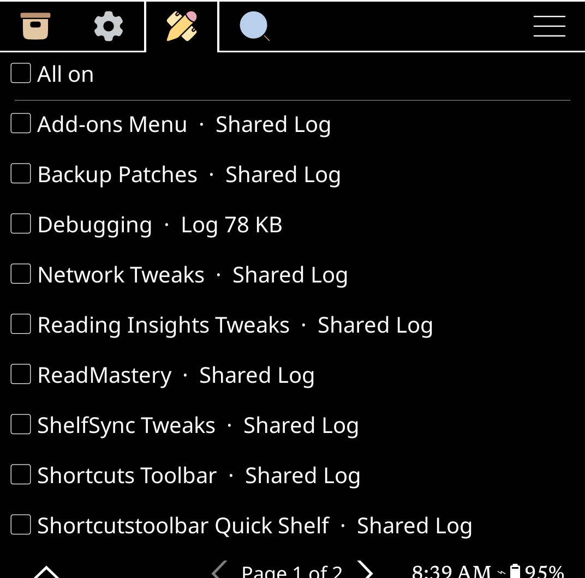

Adds **Add-ons → Debugging** (file browser only): one place to switch diagnostic patches on and off and tidy their logs. Your diagnostic patches are never edited.

- One master toggle plus a checkbox per diagnostic. Turning one off moves it to `patches/debug/`, so KOReader doesn't load it and it costs nothing. Changes apply after a restart (asked once).
- All diagnostics write to one shared log (`koreader/diagnostics.log`), each line tagged with the diagnostic's short name, so a full test run reads as a single chronological file.
- **Combine logs for sending:** writes the shared log plus the end of `crash.log` into one file: `koreader/debug-all.log`.
- **Delete all logs:** clears every .log except version.log and crash.log, plus the diagnostics' stamp/state files (including orphaned ones from removed patches), restarting their time windows. Asks first. Hold a diagnostic to filter its lines out of the shared log, or delete its log lines and the patch itself.
- Shows `crash.log` size, with "Clear crash.log" to empty it. `version.log` (KOReader's update history) is never touched.

---

## Network Tweaks

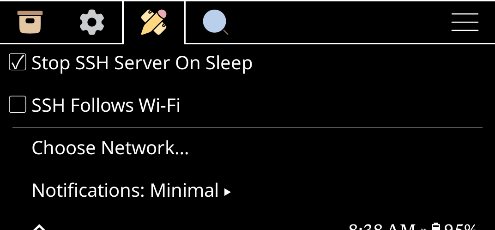

Wi-Fi, SSH and Calibre behaviour in one place. Menu: Settings (gear) → Network → Network Tweaks (or Tools → Add-ons with the Add-ons menu installed).

- **Stop SSH Server On Sleep** (on): stops KOReader's SSH server when the device sleeps, like Wi-Fi, and doesn't restart it on wake. Without this, SSH quietly becomes reachable again as soon as Wi-Fi reconnects.
- **SSH Follows Wi-Fi** (off): SSH starts when you turn Wi-Fi on and stops whenever Wi-Fi goes off, however that happens. It isn't started by the automatic reconnect after waking, so SSH stays off after sleep. Handy for pushing patches.
- **Choose Network…:** scans (tap the scanning message to cancel) and lists networks as Connected, Saved, Saved · away, or Open. Tap one for Reconnect / Edit password / Forget, or Disconnect when connected. It never connects by itself: with Wi-Fi off (Kobo) the radio comes up just for the scan, and closing the list without picking puts Wi-Fi back off.
- **Bluetooth…** (only with kobo.koplugin, on devices it supports): the plugin's Bluetooth menu — on/off, scan, paired devices, settings — moved here from Settings → Network. On MTK Kobos Bluetooth shares the Wi-Fi chip, so the patch also keeps the hand-off sane: one Wi-Fi restore at a time, and Wi-Fi on/off taps during Bluetooth start-up are applied once it's up.
- **Notifications** (default Banner): one style for Wi-Fi on/off, SSH on/off and the Calibre wireless connection, however you trigger them.
  - **Normal:** stock KOReader popups; Wi-Fi waits until connected.
  - **Minimal:** Wi-Fi connects in the background, with small corner notes (top right) like "Wi-Fi connected", "SSH on", "Calibre connected".
  - **Banner:** Wi-Fi connects in the background with a banner at the top ("Connecting to Wi-Fi… tap here to cancel", then "Connected to <network>"). SSH shows what you need to connect, for example `SSH on · 192.168.1.23:2222`, and Calibre shows the server it connected to.
- **Shared notification style:** every patch's status notes use this style when Network Tweaks is installed — Banner, Minimal corner note, or Normal (the patch shows its own popup). Without Network Tweaks, patches fall back to ReadMastery Notify's style when that's installed, otherwise their own default. Nothing ever shows over the sleep screen.
- **Cancel Wi-Fi Connection** (only shown while connecting): stops a background connect. You can also tap the banner, or tap the Wi-Fi toggle again. A connect in progress is also cancelled when the device goes to sleep.

A failed Wi-Fi connect always shows a note at the top; tap it to choose a network. Long-press the Wi-Fi toggle in the network menu for the normal flow with the network list.

**Notes**
- Background connect uses the device's own Wi-Fi config, the same one the automatic reconnect on wake uses. On Kobo that means networks joined in Kobo's own Wi-Fi settings; networks joined only in KOReader aren't in it. If that config has no networks, the Normal flow is used instead. Background connect needs Kobo or Kindle.
- Shortcuts Toolbar Icon Tweaks' SSH and Calibre indicators update the moment they change with Network Tweaks 1.4.0+.

---

## ShelfSync Tweaks

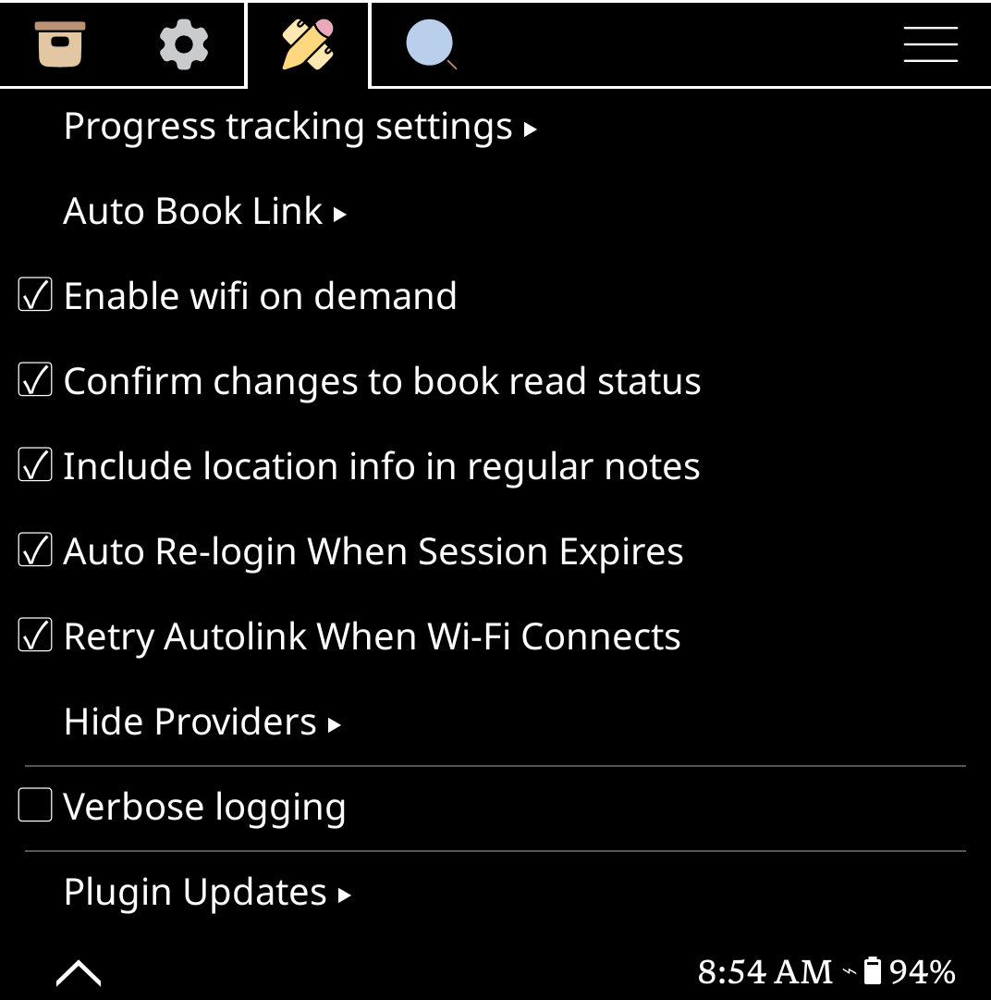

Checked against ShelfSync 1.7.0; the bundled Goodreads login code is a goodreadskosync 1.15.0 snapshot (MIT, license in the file). Sync messages follow the shared notification style when Network Tweaks or ReadMastery Notify is installed.

- **Goodreads login on device:** a Log In button (email + password) in ShelfSync → Providers → Goodreads → Account, same as StoryGraph's. Login code is bundled from `goodreadskosync` (MIT, license in the file), so that plugin isn't needed.
- **Remember login** for Goodreads and StoryGraph: tap "Log In As…" to sign in with the saved login, long-press to edit, "Forget Saved Login" to remove it.
- **Goodreads WAF fix:** search and security-token requests use `/book/auto_complete` and `/review/list` to get around Amazon's bot check, falling back to the originals if they fail.
- **New toggles in ShelfSync → Settings** (above Verbose logging):
  - Auto Re-login When Session Expires (on).
  - Retry Autolink When Wi-Fi Connects (on).
  - Hide Providers: Fable, Hardcover, Goodreads, Pagebound, StoryGraph, LibraryThing (all off). Hiding a provider also stops it doing anything. Menu changes show after reopening the book / file browser.
- **Link & Update:** every enabled provider's Link Book and Update Status in one menu, with three gesture actions that open these pages directly (Link & Update Menu, Link Book (All Providers), Update Status (All Providers)).
- **ShelfSync All: Update Progress** (gesture), in order: turns Wi-Fi on if needed, syncs to every linked, enabled provider that tracks reading progress (one retry each; LibraryThing keeps none, so it's skipped), lists providers still unlinked, then turns Wi-Fi back off if it turned it on. ShelfSync's built-in "Update progress for all linked books" also turns Wi-Fi on first and off after.
- **Autolink retry on connect:** books opened offline get linked when Wi-Fi connects.
- **Auto re-login:** if a saved-login session expires, it signs in again and re-sends progress for the open book, at most once per provider per 30 minutes. A Goodreads verification code or captcha still prompts you.
- **Security:** logins stay on the device (`koreader/settings/shelfsync_*_login.lua`), encrypted with a device-local key. That protects against casual browsing, not full device access.

---

## ReadMastery Notify

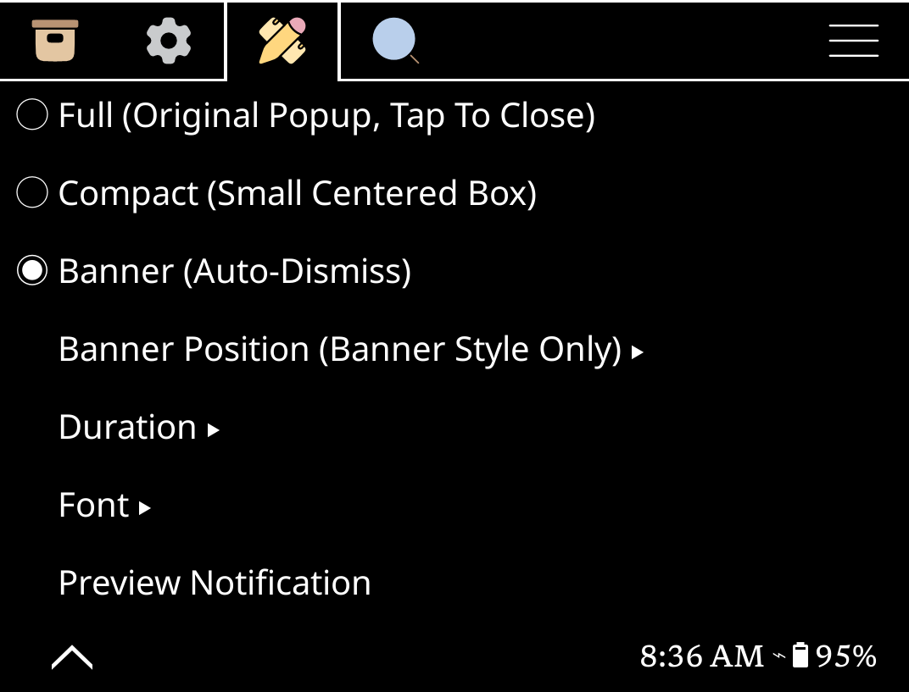

A customizable notification system for ReadMastery: XP, quests, level-ups and reading progress. Designed to feel rewarding without getting in the way while reading. Doesn't edit any ReadMastery file; settings live in their own file (`settings/ReadMastery_notify.lua`).

Two top-level toggles above the settings menu:
- **Notifications:** master ON/OFF for everything below.
- **Nudges:** 80%/90% "almost there" notices from the quest patch (informational only, no XP). Greyed out whenever Notifications is off.

Everything else lives under ReadMastery → Settings → Notification Settings:
- **Style:** Full is ReadMastery's original popup (tap to dismiss). Compact is a small centered box, auto-dismiss or tap, that can mix your chosen font with a monospace font for achievement art. Banner is a corner or full-width toast that auto-dismisses and never blocks reading or page turns.
- **Banner Position:** Top Left, Top Right, Bottom Left, Bottom Right, Full Width (Top), Full Width (Bottom).
- **Duration:** how long Compact and Banner stay up.
- **Font:** a grouped list of fonts already on your device, or KOReader's default.
- **Preview Notification:** fires a real Level 1 level-up using your current settings, so you can check changes without waiting for a real one.

Level-ups show a cosmetic title badge at certain milestone levels (for example "Established Reader" at 10). Achievements show their own pixel-art icon in Compact and Banner. Several notifications close together queue and show one at a time.

---

## ReadMastery Quests

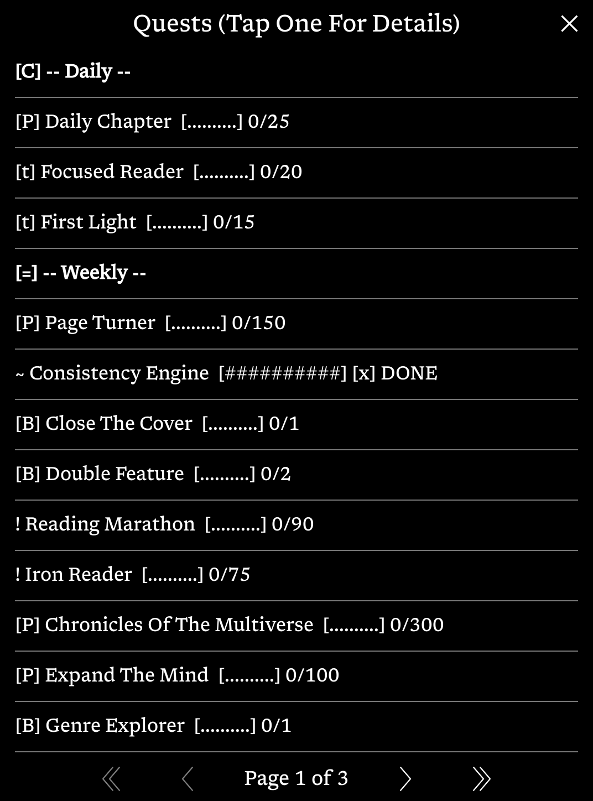
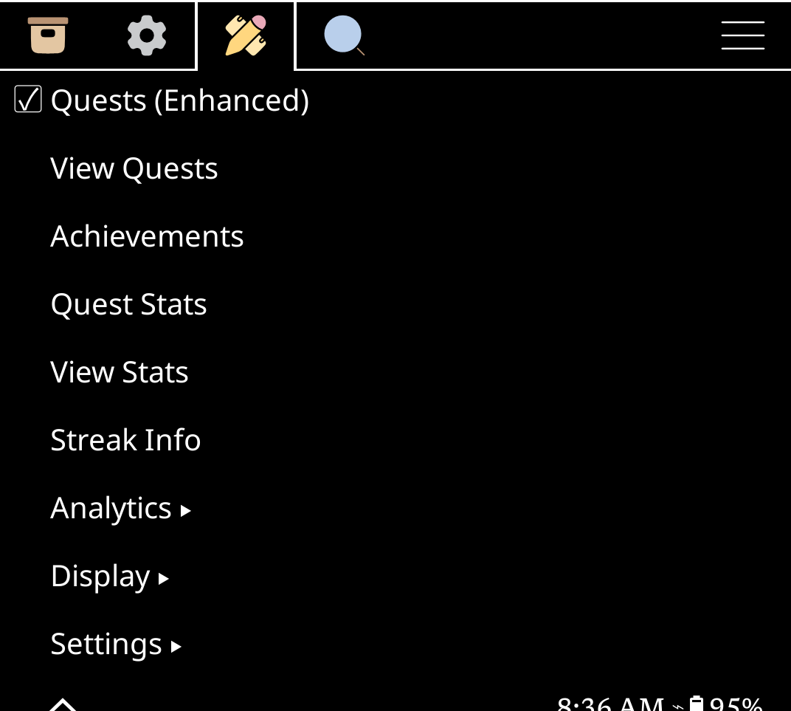

Drop this alongside ReadMastery Notify and restart. Independent, optional add-on: without Notify, quest-complete popups fall back to a plain default box.

Adds one top-level menu toggle, **Quests (Enhanced)**.

- **OFF (default):** zero overhead. The tracking hooks do nothing extra and "View Quests" is greyed out.
- **ON:** tracks quests using ReadMastery's own live session data (pages, minutes, streak, book events), with no separate tracking system. Awards XP through ReadMastery's own `addXP()`, so it shows up in your real XP and level, and fires a "Quest Complete" popup through the same styled, queued notification pipeline as achievements.

"View Quests" shows a live list with a progress bar per quest; tap any quest to see what it needs.

- **Daily** (resets 3 AM): Daily Chapter and Focused Reader are always active, plus one quest rotating in from a pool (Deep Dive, Night Owl, First Light, Literary Lunch Break, Evening Escape).
- **Weekly** (resets Monday): includes Page Turner, Consistency Engine, Reading Marathon, Iron Reader, tag-based page quests, Genre Explorer and The Final Stretch.
- **Monthly** (resets the 1st): includes Bibliophile, The Endurance Trial, book-length tiers (Brick Slayer / The Long Haul / Leviathan; only the highest tier a book qualifies for pays out), Change of Scenery and Genre Hopper.
- **Seasonal and yearly** quests are included as well.

Turning it OFF just pauses tracking and keeps progress. To reset quest progress, use ReadMastery's own **Settings → Reset Progress**, which also clears quest state and Quest Stats. This patch never opens or writes ReadMastery's `data.json` directly.

---

## Kobo Style Sleep Screen Banner


Redesigns KOReader's banner-type sleep screen message to look like the Kobo lock screen tag, showing a random highlight from the current book.

- **Quote fallback:** books with no highlights show a random quote from a text file. Put `Famous Quotes.txt` at `/mnt/onboard/Famous Quotes.txt`, or change `file_path` at the top of the patch.
- **No repeats:** highlights and quotes each have their own no-repeat window. The highlight window is scoped per book, so it no longer carries across unrelated books.
- **Seeded randomness:** picks stay varied across restarts.
- **Live quote file:** edits to the quote file are picked up without restarting.
- **Lighter sleep:** it only reads highlights, so there's no settings flush on every sleep.

Title, stats and highlight fonts, sizes, border, margin and max width are configurable in the settings tables at the top of the file.

Credits: written with Discord user @sandcastles, with design cues from a patch by u/juancoquet.

---

## Track Reading Location

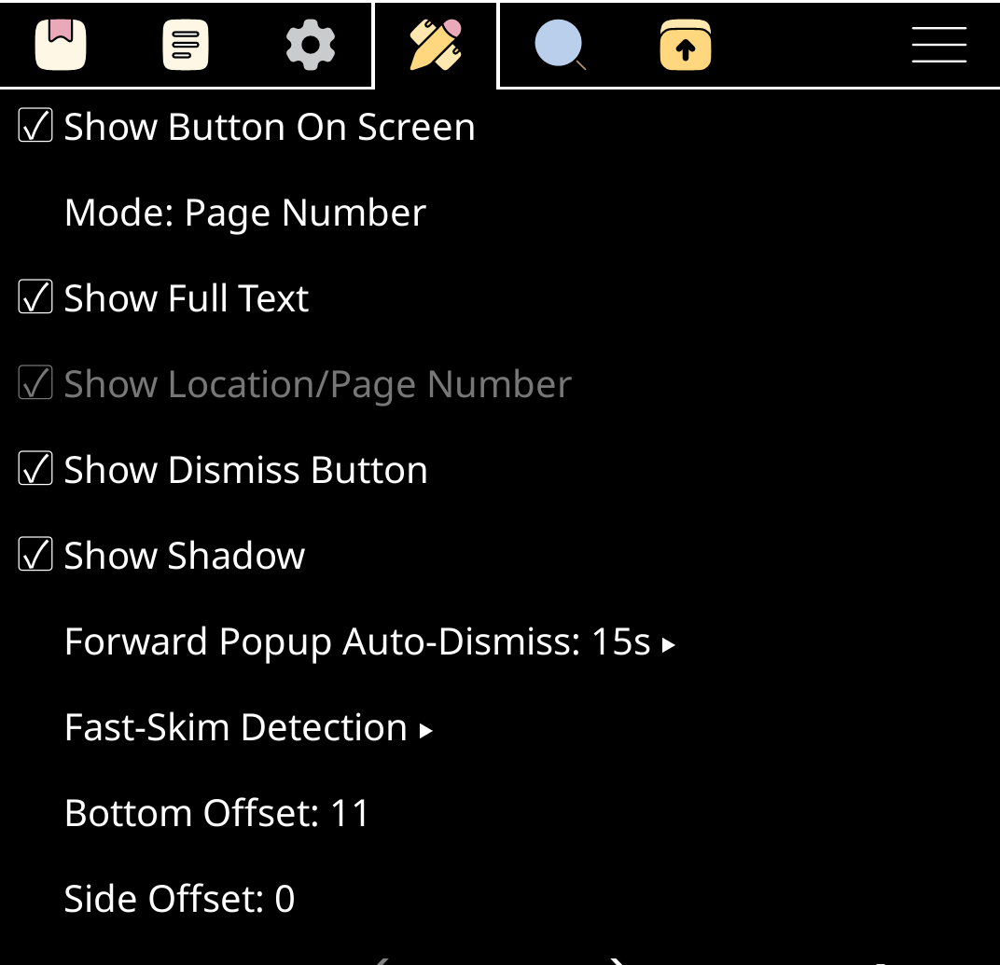

Remembers the furthest page you've actually read. If you page back, or jump ahead through the table of contents, a small floating button takes you back. The button is drawn as an overlay, so it never blocks taps elsewhere.

- **Backward:** paging back more than one page (one at a time or in a single jump) shows a persistent button at the bottom right.
- **Forward:** jumping ahead more than two pages at once, or skimming 4+ pages in quick succession, shows a mirrored button at the bottom left. It auto-dismisses after Off/15/20 (default)/30/50s. After it times out, the page you were on becomes the anchor and a big jump (search, TOC, progress bar) gets the usual go-back popup.
- **Dismiss:** tap the "X" (or hold the button if the X is hidden) to accept your current page as the new reference point.
- **Layout:** docks above KOReader's footer when the footer reserves its own space.
- **Position:** on EPUB/FB2, position is tracked by xpointer, so font or margin changes don't point "go back" at the wrong page.
- **Saving:** per book, saved when you accept a page and on suspend; skips the disk write when nothing changed; cleans up timers on close.

Menu: Reader menu → Navigation → Reading Location, with "Go To Furthest Reading Location", "Set Current Page As Reading Location" (both bindable to gestures), and Settings: show button, full text, page number, dismiss button, page/percentage mode, shadow, bottom and side offsets, button radius, and forward auto-dismiss.

---

## Shortcuts Toolbar Icon Tweaks

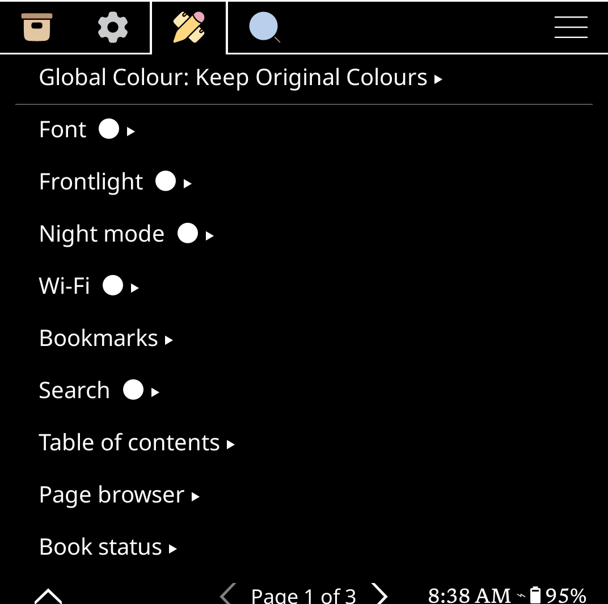
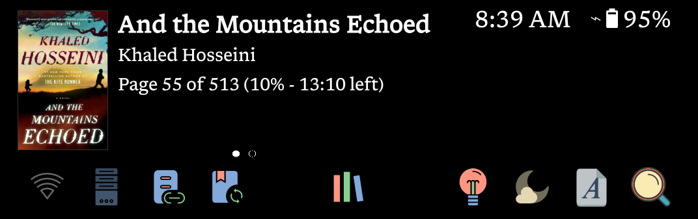

Adds **Shortcuts toolbar → Icon tweaks** for the shortcutstoolbar plugin. Works in the reader menu, file-browser bar/persistent bar and the SimpleUI home-screen module, and doesn't modify any plugin files.

- **Custom icons:** swap any icon for your own SVG/PNG, or restore the original.
- **Colour mode**, globally or per icon: Default (follows Night Mode), Keep original (true colours in Night Mode), or Inverted.
- **On/off indicators**, per icon: follow Wi-Fi, frontlight, Night Mode, SSH server, Calibre connection, or a remembered tap toggle. Off/on styles are dim when off, inverted tile when off or on, or an alternate "off" icon.
- **Menu Toggle and Bluetooth indicators:** a custom shortcut set to a menu action can follow that item's own checkmark, and Bluetooth follows the Kobo plugin's Bluetooth state.
- **Live network state:** the Wi-Fi icon and any Wi-Fi/SSH/Calibre indicator follow the real state, including background connects, failures, cancels, auto-disconnect and sleep.
- **Toolbar stays open** after tapping custom SSH, Wi-Fi, Calibre or Night Mode shortcuts, so you see the icon change. Other actions still close it.
- **Hold actions:** hold the built-in Wi-Fi button for the network list (Network Tweaks' picker when installed); hold the built-in Restart or Search button for Restart / Exit KOReader / Reboot / Power off. Tap does what it always did.
- **Sleep:** an open reader or library top menu closes when the device goes to sleep, so you wake to the page, not the menu.

Cost: icons you leave untouched get no hooks. Nothing runs in the background or while asleep.

---

## Shortcuts Toolbar Quick Shelf

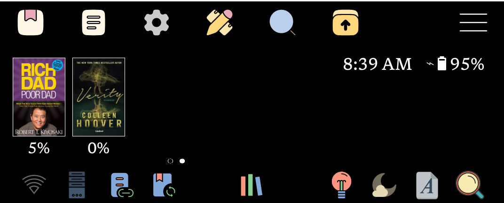

For the shortcutstoolbar plugin (reader menu only). Swipe left or right on the toolbar's top book row to flip between the book info panel and a Quick Shelf strip of up to 5 books — tap a cover to switch to that book. Two dots show which page you're on; every menu open starts on the book panel.

- **Quick Shelf Shows:** Books In Progress (started and not finished, most recent first — the open book left out, progress under each cover) or the To Be Read collection. Switch it in Shortcuts toolbar → Quick Shelf Shows.
- Covers come from thumbnails SimpleUI or CoverBrowser already keeps — a book is never opened to pull its cover. A book with no saved thumbnail gets a title tile.
- **Cost:** nothing until you swipe. The strip builds on the first swipe of a menu open and is reused after that; a swipe redraws only the top row. No timers. Works alongside Shortcuts Toolbar Icon Tweak.

---

## X-Ray Direct Lookup

**Discontinued.** xray.koplugin 26.10.23-beta and later includes this natively as "Auto-Popup on Highlight" (Settings → X-Ray Mode Settings). Delete `2-xray-direct-lookup.lua` and `debug/2-zz-xray-direct-lookup-diagnostics.lua` from your patches folder and restart.
---

## Reading Insights Tweaks

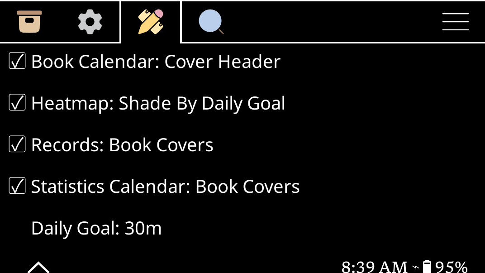

Enhances Reading Insights and the built-in Statistics calendar with cover art and goal-shaded views. Each feature has its own toggle, and toggles apply without a restart. Built for Reading Insights 8.1+, which now has its own streak calendar covers, tap-a-day and sleep screen — this patch keeps the extras it doesn't do.

1. **Book calendar header:** cover, title and author under the month title of the Book progress calendar.
2. **Heatmap goal shading:** heatmap shaded against your daily goal (darkest = goal met) instead of your busiest day.
3. **Record covers:** cover art for your records (most time in a day, most pages in a day, best streak). Tap one for book details or to open the book.
4. **Statistics calendar:** KOReader's built-in Statistics calendar gets covers instead of title bars and a time badge shaded by your daily goal. Tapping a day still opens its day view.

**2.0.0 removed** the streak calendar covers, taller cover cells, tap-a-day and the sleep screen card (all native in Reading Insights 8.1+ now); their saved settings are cleared once on first start.

**Install:** copy `2-readinginsights-tweaks.lua` into `koreader/patches/` and restart once. Replaces `2-readinginsights-covers.lua` and `2-cover-calendar.lua` if you have them (delete those).

**Requirements:** Reading Insights plugin ([peterboda236/readinginsights.koplugin](https://github.com/peterboda236/readinginsights.koplugin)) 8.1 or newer installed, and CoverBrowser enabled. Covers come from CoverBrowser's cache; an uncached cover shows its title and appears the next time the view is drawn.

**Configuration:** Tools → Add-ons → Reading Insights Tweaks (with the Add-ons menu installed), otherwise Tools → Reading Insights Tweaks. Daily Reading Goal is adjustable in the same menu.

**How it works:** Reading Insights loads its files through the global `loadfile`. This patch wraps that for three of its view files: the book calendar gets a small source addition routing one function through here, while the heatmap and records views are patched on the module table they return. The Statistics calendar is patched when KOReader's Statistics plugin loads. Update-safe: every addition looks for exact source lines first, and if a Reading Insights update changes them, that feature is skipped (logged as `RI tweaks:`) and the stock view is used. Any error while drawing falls back to stock too.

**Cost:** nothing runs in the background. Work happens only when you open one of these views. Scaled covers are kept for the session (max 150), and the only timer is a one-shot 30s retry window after a missing cover was sent for extraction.
## QuickMenu Toggle State

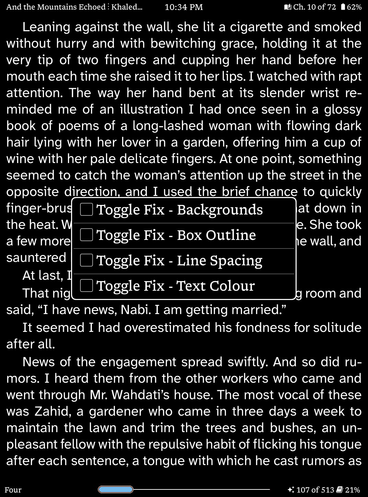

When a multi-action gesture is set to "Show as QuickMenu", toggle actions get a checkbox prefix — "✓" when on, "▢" when off (the same glyphs KOReader's own menus use, rendered as text so they always display). The marker goes first on purpose: the popup truncates long labels from the end.

- **Style tweaks:** any `style_tweak_*` toggle action (stock tweaks and custom CSS files) reads its live state from the current book. The `style_tweak_set_*` setter actions are left alone.
- **X-Ray Direct Lookup:** the `xray_direct_lookup_toggle` action reads the toggle's settings mirror.
- Renamed actions (custom names via "Rename QuickMenu actions") are annotated too. With "keep menu open" on, checkboxes show the state from when the menu opened — reopen the menu to refresh. In the file browser (no book open), style tweak entries show without a checkbox.

---

## List Rating Progress

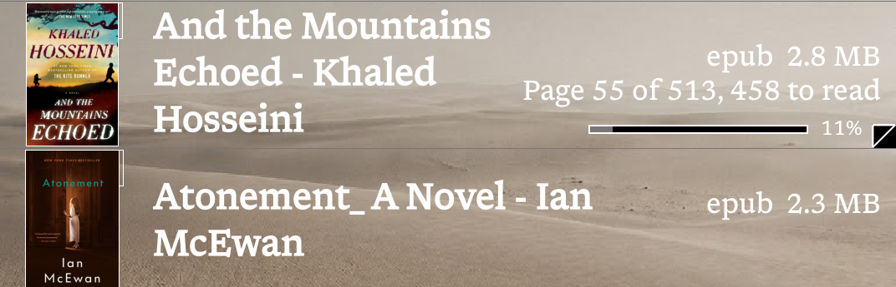

Adds a star rating and reading progress bar to CoverBrowser's list ("detailed list") view in the File Manager, History, and Collections. Drawn in the bottom-right of each book row, left of the dogear. Nothing is drawn for books that have never been opened.

- **Config:** show/hide stars, progress bar, and percentage; star size, bar height/width, and margins adjustable in the CFG table at the top of the file.
- Ratings and progress are read from each book's sidecar file. Books marked complete show 100%.

---

## Custom Quotes for SimpleUI

`Quotes.lua` has 300 famous quotes for SimpleUI's Quote of the Day module.

1. Copy it to `koreader/settings/simpleui/sui_quotes/`, creating the folders if needed.
2. In the module's settings, set Source → Custom and pick the file.

`Famous Quotes.txt` is a separate file for the sleep screen banner's quote fallback (see above).

---

## Credits

These patches wouldn't exist without the plugins they build on and the people behind them:

- **[SimpleUI](https://github.com/doctorhetfield-cmd/simpleui.koplugin)** by Doctor Hetfield — the home screen the SimpleUI Tweaks patch extends.
- **[Shortcut Toolbar](https://github.com/xusoo/shortcutstoolbar.koplugin)** by xusoo — the toolbar the Icon Tweaks and Quick Shelf patches customize.
- **[Reading Insights](https://github.com/peterboda236/readinginsights.koplugin)** by peterboda236 — the stats plugin the Reading Insights Tweaks patch builds on.
- **[ReadMastery](https://github.com/Lalocaballero/readmastery.koplugin)** by Lalocaballero — the gamification plugin the ReadMastery patches hook into.
- **[Storefront](https://github.com/ultimatejimmy/storefront.koplugin)** by ultimatejimmy — the plugin browser the patches are listed on.
- **[@sandcastles](https://discord.com)** (Discord) — co-wrote the Kobo-Style Sleepscreen Banner patch with TK.
- **[u/juancoquet](https://www.reddit.com/user/juancoquet/)** — design cues for the sleepscreen banner.

And [KOReader](https://github.com/koreader/koreader) itself, which makes all of this possible.
